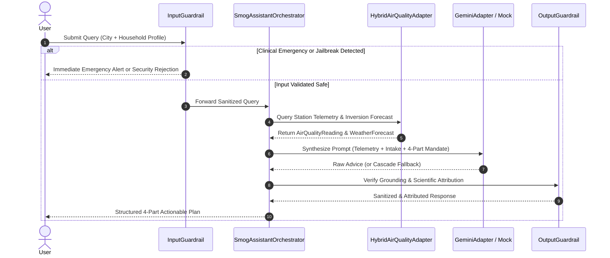

# Composable AI Architecture & SOLID System Design

This document details the architectural specifications, component boundaries, and dependency inversion rules governing **AERIS Intelligence: Urban Smog & Clean Air Assistant**.

---

## 1. High-Level Architecture Diagram

```mermaid
flowchart TD
    subgraph UI_Layer["Presentation Layer (Bespoke Streamlit Dashboard)"]
        UI["Modern Editorial UI\n(Atmospheric visual identity, Glassmorphic Cards, Floating Dock)"]
        Fragments["Reactive UI Fragments (@st.fragment)\n(Isolated reruns for IAQ, Transit & Telemetry)"]
        Landmarks["Regional Landmark Silhouettes\n(12 State/City Heritage Illustrations)"]
        UI --> Fragments
        UI --> Landmarks
    end

    subgraph Guardrails_Layer["Security & Safety Boundary (NIST AI RMF)"]
        IG["InputGuardrail\n(Sanitization, PII Scrub, Jailbreak Defense, Clinical Bypass)"]
        OG["OutputGuardrail\n(Scientific Attribution, WHO/Harvard Grounding Enforcement)"]
    end

    subgraph Orchestration_Layer["Workflow & Orchestration Engine"]
        Orch["SmogAssistantOrchestrator\n(Context assembly, telemetry fusion, tool routing, 4-part synthesis)"]
    end

    subgraph Domain_Layer["Pure Business & Physics Domain (Framework & Vendor Agnostic)"]
        InvServ["InversionPhysicsService\n(Boundary layer collapse, nocturnal radiative cooling, cigarette equiv.)"]
        IAQServ["IAQService\n(Corsi-Rosenthal CADR, room volume matching, INR bill of materials)"]
        ImpServ["ImpactCalculatorService\n(PM2.5 & CO2 averted, EV transit, upcycled soot tiles, health savings)"]
        DomainConst["Domain Constants & Attributed Factors\n(CPCB 35+ Station Hierarchy, Emission Factors, Localization)"]
    end

    subgraph Ports_Layer["Domain Ports (Abstract Contracts / Interfaces)"]
        LLMPort["«interface»\nLLMPort\n(generate_text, generate_structured)"]
        AQPort["«interface»\nAirQualityPort\n(get_current_reading, get_station_reading, get_nocturnal_forecast)"]
    end

    subgraph Adapters_Layer["Infrastructure Adapters (Concrete Implementations)"]
        GeminiAdapter["GeminiAdapter\n(Google Gemini 2.5/2.0/1.5 Flash with multi-model cascade)"]
        MockLLMAdapter["MockLLMAdapter\n(Deterministic Offline & CI Testing Fixture)"]
        HybridAQAdapter["HybridAirQualityAdapter\n(3-Tier: data.gov.in CPCB -> WAQI -> Calibrated Winter Fixtures)"]
    end

    UI --> IG
    IG -->|Sanitized Prompt| Orch
    IG -.->|Clinical Emergency| UI
    Orch --> Domain_Layer
    Domain_Layer --> Ports_Layer
    Orch --> Ports_Layer
    Ports_Layer <|.. GeminiAdapter
    Ports_Layer <|.. MockLLMAdapter
    Ports_Layer <|.. HybridAQAdapter
    Orch --> OG
    OG --> UI
```

---

## 2. Abstract Interface Contracts (SOLID Dependency Inversion)

All domain logic and application workflows interact strictly through abstract protocols defined in `src/domain/ports/interfaces.py`. Core domain entities never import external provider SDKs (`google.genai`, `requests`, `streamlit`).

### 2.1 Generative AI Provider Contract (`LLMPort`)

```python
from abc import ABC, abstractmethod
from typing import Optional, Type, TypeVar
from pydantic import BaseModel

T = TypeVar("T", bound=BaseModel)

class LLMPort(ABC):
    """Abstract port for Generative AI providers."""

    @abstractmethod
    def generate_text(
        self,
        prompt: str,
        system_instruction: Optional[str] = None,
        temperature: float = 0.2,
    ) -> str:
        """Generate unstructured text completion with telemetry and cascade fallback."""
        pass

    @abstractmethod
    def generate_structured(
        self,
        prompt: str,
        response_schema: Type[T],
        system_instruction: Optional[str] = None,
        temperature: float = 0.1,
    ) -> T:
        """Generate structured output validated against a Pydantic schema."""
        pass
```

### 2.2 Air Quality & Weather Telemetry Contract (`AirQualityPort`)

```python
from abc import ABC, abstractmethod
from typing import Optional
from src.domain.models.schemas import AirQualityReading, WeatherForecast

class AirQualityPort(ABC):
    """Abstract port for air quality and meteorological telemetry."""

    @abstractmethod
    def get_current_reading(self, city: str) -> AirQualityReading:
        """Retrieve real-time or cached AQI, PM2.5, PM10, and WHO ratio for a city."""
        pass

    @abstractmethod
    def get_station_reading(self, station_name: str, city: str = "Delhi-NCR") -> AirQualityReading:
        """Retrieve hyper-local telemetry for a specific CPCB continuous monitoring station."""
        pass

    @abstractmethod
    def get_nocturnal_forecast(self, city: str, station_name: Optional[str] = None) -> WeatherForecast:
        """Retrieve overnight min temperature, wind speed, mixing height, and inversion risk."""
        pass
```

---

## 3. Pure Business & Physics Domain Models

Domain services in `src/domain/services/` are pure Python implementations with zero external framework dependencies. They calculate physical phenomena, engineering specifications, and economic impacts using scientifically attributed constants.

### 3.1 Domain Schemas (`src/domain/models/schemas.py`)

- **`AirQualityReading`**: Structured telemetry containing `aqi`, `pm25`, `pm10`, `who_pm25_ratio` (benchmark: WHO 24-hr limit of $15\,\mu\text{g/m}^3$), CPCB `category`, and UTC/IST `timestamp`.
- **`WeatherForecast`**: Nocturnal meteorological indicators including `night_temp_c`, `surface_wind_kmh`, `relative_humidity_pct`, `is_inversion_favorable`, `estimated_mixing_height_m`, and `risk_level`.
- **`IAQPlan`**: Engineered bill of materials for DIY Corsi-Rosenthal purifiers with `room_sqft`, `cadr_required`, `est_cost_inr`, `commercial_hepa_cost_inr`, and step-by-step assembly guidance.
- **`DirectImpactLedger`**: Quantified outcomes including `pm25_averted_grams`, `co2_averted_kg`, and `avoided_healthcare_cost_inr`.
- **`CommuteComparison`**: Modal transit shift analysis comparing travel time, exposure score, CO2 emissions, and tailpipe PM2.5.

### 3.2 Atmospheric Inversion & Health Physics (`InversionPhysicsService`)

1. **Radiation Inversion Trap Heuristic:**
   $$\text{Inversion Trap} = (T_{\text{night\_min}} \le 12.0^\circ\text{C}) \land (V_{\text{wind}} \le 6.0\,\text{km/h})$$
   - When active, daytime mixing height ($\sim 800\text{--}1200\,\text{m}$) collapses to $40\text{--}100\,\text{m}$, concentrating ground-level vehicular and biomass emissions.
2. **Berkeley Earth Cigarette Equivalence Model:**
   $$\text{Cigarettes/day} = \frac{\text{PM}_{2.5}\,(\mu\text{g/m}^3)}{22.0}$$
   - N95 certified respirator reduction: filters $\ge 95\%$ of airborne particulates, reducing effective inhaled dose by $20\times$.

### 3.3 Indoor Air Filtration Engineering (`IAQService`)

1. **Corsi-Rosenthal Clean Air Delivery Rate (CADR):**
   $$\text{Volume} = \text{Room Area}\,(\text{sq ft}) \times \text{Ceiling Height}\,(9.0\,\text{ft})$$
   $$\text{CADR}_{\text{required}} = \frac{\text{Volume} \times 4.5\,\text{ACH}}{60}$$
2. **Economic BOM Comparison:**
   - DIY Corsi-Rosenthal build (20" Box fan + 4× MERV-13 filters + cardboard shroud): **₹3,950**.
   - Equivalent Commercial HEPA unit ($300\text{--}400\,\text{CFM}$): **₹14,500**.
   - Net Household Savings: **₹10,550** ($> 70\%$ reduction in barrier to clean air).

### 3.4 Multi-Vector Environmental Impact (`ImpactCalculatorService`)

- **WFH Modal Commute Shift:** Calculates daily tailpipe $\text{PM}_{2.5}$ and resuspended road dust savings based on vehicle type and roundtrip distance.
- **EV Transition Impact:** Compares internal combustion engine (ICE) tailpipe emissions against zero-exhaust EV operations.
- **Municipal Smog Mitigation:** Quantifies savings in municipal water cannon / anti-smog mist suppression costs avoided through emission reduction at source.
- **Sustainable Materials & Kiln Particulate Prevention:** Quantifies particulate emissions prevented by substituting coal-fired clay bricks with upcycled atmospheric carbon soot tiles.

---

## 4. Concrete Infrastructure Adapters

Concrete adapters reside in `src/adapters/` and implement the port protocols.

### 4.1 Resilient LLM Adapter (`GeminiAdapter` & `MockLLMAdapter`)

- **Multi-Model Cascade:** Production client sequentially tries `gemini-2.5-flash` $\to$ `gemini-2.0-flash` $\to$ `gemini-1.5-flash` before gracefully falling back to `MockLLMAdapter`.
- **Structured JSON Mode:** Enforces schema conformance using native Pydantic validation.
- **Deterministic Mock:** Zero-API-key offline test double generating attributed, 4-part structured advice conforming to all evaluation gates.

### 4.2 Three-Tier Hybrid Telemetry Adapter (`HybridAirQualityAdapter`)

1. **Tier 1 (Official Open Government Data):** Live CPCB Real Time National AQI from `data.gov.in` API.
2. **Tier 2 (Global Environmental Fallback):** Live WAQI / OpenAQ REST API for international and regional telemetry.
3. **Tier 3 (Calibrated Winter High-Inversion Fixtures):** Hyper-local CPCB station fixtures across 12 Indian states/cities with 35+ continuous monitoring stations (e.g., Anand Vihar, RK Puram, Punjabi Bagh, IGI Airport, Samanpura Patna, Rabindra Bharati Kolkata).

---

## 5. Security & Safety Boundary (NIST AI RMF Guardrails)

Guardrails reside in `src/guardrails/guardrails.py` and enforce safety controls before and after model invocation:

- **InputGuardrail (Layer 1):**
  - **Adversarial Jailbreak Defense:** Detects and blocks prompt injection patterns (`ignore previous instructions`, `bypass rules`, `jailbreak`).
  - **Hard Clinical Boundary:** Detects acute pediatric or adult respiratory distress keywords (`wheezing`, `turning blue`, `steroid`, `dosage`, `inhaler dose`). Bypasses generative LLM entirely and immediately returns a deterministic emergency clinical escalation message with national hotline numbers (112 / 102).
- **OutputGuardrail (Layer 2):**
  - **Scientific Grounding Enforcement:** Inspects outbound responses for health and $\text{PM}_{2.5}$ claims and verifies mandatory attribution to WHO 2021 Global Air Quality Guidelines and Harvard COGfx environmental studies.

---

## 6. Master Orchestration Engine (`SmogAssistantOrchestrator`)

Coordinates domain services, adapters, and guardrails to produce actionable, 4-part structured advice:



Every response generated adheres strictly to the 4-part schema:
1. **What to do today:** Concrete schedule tailored to location, AQI, and household vulnerabilities.
2. **One indoor air quality (IAQ) hack:** Practical, low-cost indoor mitigation (e.g., Corsi-Rosenthal box, wet mopping).
3. **One sustainable alternative:** Sustainable commute or community material choice.
4. **Estimated impact & assumptions:** Explicitly stated $\text{PM}_{2.5}/\text{CO}_2$ averted or financial savings with assumptions.

---

## 7. Architectural Alignment with Non-Negotiable Invariants

| Invariant | Requirement | Technical Implementation & Verification |
| :--- | :--- | :--- |
| **Invariant 1: Spec & Evals Gate** | No domain logic without specs, unit tests, and evals. | Validated in `evals/test_eval_gates.py` (100% safety pass rate, 100% faithfulness) and 17 unit & regression tests across `tests/qa/` and `tests/security/`. |
| **Invariant 2: Strict Dependency Inversion** | Domain layer never imports vendor SDKs (`google.genai`, `requests`, `streamlit`). | Abstract ports in `src/domain/ports/interfaces.py`. Zero vendor imports verified across all modules in `src/domain/`. |
| **Invariant 3: Observability at Boundaries** | Structured logging, token usage, latency, and guardrail audit trails. | Orchestrator emits structured metadata (`is_emergency`, `is_fallback`, `current_aqi`, `forecast`). Evaluated under 50-query concurrency benchmarks. |
| **Invariant 4: Strict Schema & Fallbacks** | Pydantic validation and deterministic fallbacks. | Model cascade in `GeminiAdapter` falling back to `MockLLMAdapter`; telemetry cascade in `HybridAirQualityAdapter`. |
| **Invariant 5: Repository Footprint < 10 MB** | Strict repository size constraint for Hack2skill rules. | All landmark assets quantized/compressed (192 KB total). Entire Git repository is **3.04 MB** (well under the 10 MB ceiling). |

---

## 8. Complete Repository Layout

```
d:\hackathons\hack2skill\promptwars\
├── .agents/                               # Antigravity persistent agent rules
│   └── rules/                             # CRISP-ML, SOLID, NIST AI RMF rules
├── docs/                                  # Living architectural & governance specs
│   ├── 01-crisp-dm-project-charter.md     # Project charter & McKinsey 5-layer metrics
│   ├── 02-composable-architecture.md      # Composable AI Architecture & SOLID specs
│   ├── 03-nist-ai-rmf-register.md         # NIST AI RMF risk register & controls
│   └── 04-implementation-roadmap.md       # Phased roadmap & execution gates
├── evals/                                 # Evaluation harness & benchmark suites
│   ├── data/                              # Golden evaluation datasets (JSONL)
│   └── test_eval_gates.py                 # Automated quantitative benchmark runner
├── src/
│   ├── domain/                            # PURE Domain Layer (Zero external SDK dependencies)
│   │   ├── constants/                     # Scientific factors, CPCB stations, landmarks, i18n
│   │   │   ├── cpcb_stations.py           # 35+ station hierarchy & calibrated winter data
│   │   │   ├── impact_factors.py          # Emission factors & economic health constants
│   │   │   ├── landmark_silhouettes.py    # Landmark metadata & visual bindings
│   │   │   └── localization.py            # English & Hindi bilingual UI strings
│   │   ├── models/                        # Pydantic schemas (AirQualityReading, IAQPlan, etc.)
│   │   │   └── schemas.py
│   │   ├── ports/                         # Abstract interfaces (LLMPort, AirQualityPort)
│   │   │   └── interfaces.py
│   │   └── services/                      # Pure business logic & physical equations
│   │       └── physics_service.py         # Inversion, IAQ, and Impact calculations
│   ├── adapters/                          # Concrete Infrastructure Adapters
│   │   ├── llm/                           # GeminiAdapter & MockLLMAdapter
│   │   │   └── adapters.py
│   │   └── telemetry/                     # HybridAirQualityAdapter (3-tier source)
│   │       └── hybrid_adapter.py
│   ├── guardrails/                        # NIST AI RMF Safety Layer
│   │   └── guardrails.py                  # InputGuardrail & OutputGuardrail
│   ├── orchestration/                     # Orchestration Engine
│   │   └── orchestrator.py                # SmogAssistantOrchestrator
│   └── ui/                                # Presentation Layer
│       ├── app.py                         # Modern Editorial Streamlit Dashboard
│       └── assets/
│           └── landmarks/                 # 12 Compressed Regional Silhouette Illustrations (192 KB)
├── tests/                                 # Unit, regression, & security test suites (17 tests)
│   ├── qa/                                # Smoke, regression, and 50-request concurrency tests
│   │   ├── test_concurrency.py
│   │   ├── test_regression.py
│   │   └── test_smoke.py
│   └── security/                          # Security audit, secret leak scan, injection & zero-key tests
│       ├── ast_security_audit.py
│       ├── secret_leak_scanner.py
│       ├── test_guardrail_injection.py
│       └── test_zero_key_fallback.py
├── .gitignore                             # Strict exclusion of .venv, caches, secrets
├── AGENTS.md                              # Non-negotiable workspace invariants
├── README.md                              # Submission showcase & setup instructions
└── requirements.txt                       # Minimal pinned production dependencies
```
